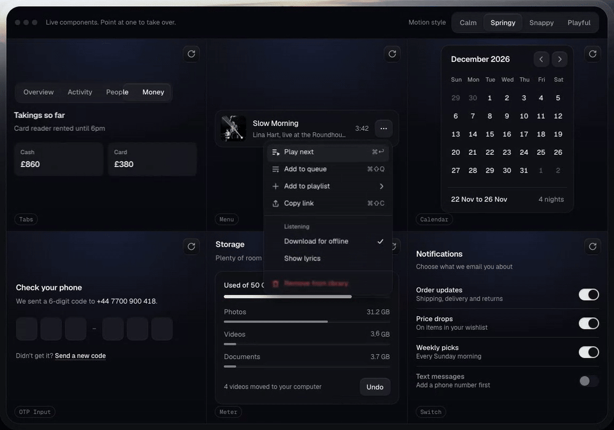
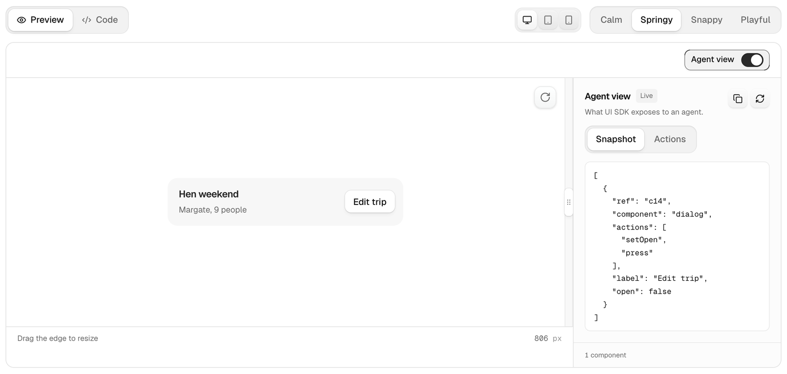
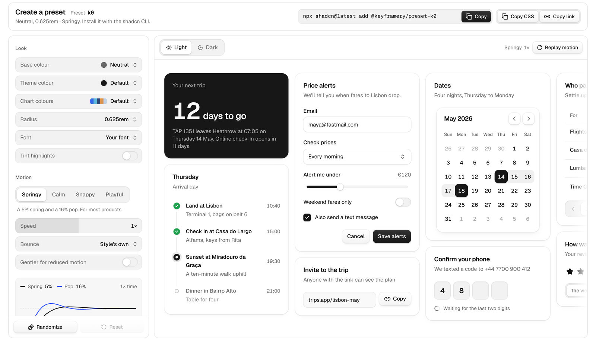
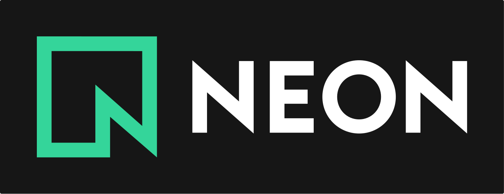

<div align="center">
  <br />
  <a href="https://keyframery.com">
    <picture>
      <source media="(prefers-color-scheme: dark)" srcset="assets/readme/logo-dark.svg">
      <source media="(prefers-color-scheme: light)" srcset="assets/readme/logo-light.svg">
      
    </picture>
  </a>
  <!-- product:header:start (written by scripts/stamp-copy.mjs from content/product.json) -->
  <h1>Keyframery</h1>
  <h3>The component library for Vercel's UI SDK.</h3>
  <p>Free, open-source components for Vercel's UI SDK: quiet by default, lively when you want it, sheets on phones and Agent view. For React and Vue.</p>
<!-- product:header:end -->
  <p>
    <a href="https://github.com/keyframery/keyframery/blob/main/LICENSE"></a>
    <a href="https://ui-sdk.dev"></a>
    <a href="https://keyframery.com/docs/installation"></a>
  </p>
  <p>
    <a href="https://keyframery.com/docs"><strong>Documentation</strong></a> ·
    <a href="https://keyframery.com/docs/installation"><strong>Installation</strong></a> ·
    <a href="https://keyframery.com/docs/components"><strong>Components</strong></a> ·
    <a href="https://keyframery.com/docs/templates"><strong>Templates</strong></a> ·
    <a href="https://keyframery.com/create"><strong>Create</strong></a> ·
    <a href="https://keyframery.com/docs/agent-view"><strong>Agent view</strong></a>
  </p>
  <br />
</div>

<a href="https://keyframery.com">
  
</a>

<!-- product:body:start (written by scripts/stamp-copy.mjs from content/product.json) -->
## What is it?

UI SDK is Vercel's library of UI behaviours: keyboard, focus, selection, accessibility and a bridge that lets AI agents read and use your interface. Keyframery is the component library on top. Every component renders UI SDK underneath and adds a finished look and motion written in plain CSS, and the shadcn CLI (shadcn-vue for Vue) copies the code into your project, so it's yours.

- **[95 components](https://keyframery.com/docs/components)**: Everything UI SDK ships, plus cards, charts, data tables, sidebars and more, each with a live demo and a Customize panel.
- **[AI components](https://keyframery.com/docs/components#ai)**: For agent interfaces: Approval, Attachment, Bubble, Diff Viewer, Markdown, Message, Message Scroller, Prompt Composer, Reasoning, Tool Call and Trace.
- **[Quiet by default](https://keyframery.com/docs/motion-styles)**: Subtle moves about as much as shadcn/ui. Calm, Springy, Snappy and Playful turn the motion up with one attribute. No animation library.
- **[Sheets on phones](https://keyframery.com/docs/components/popover)**: Popovers, menus, selects and pickers open as a sheet from the bottom edge on small touch screens, and stay popovers everywhere else.
- **[Agent view](https://keyframery.com/docs/agent-view)**: See the snapshot an AI agent reads from every component and run its actions. A skill for Claude Code and a prompt for any coding agent.
- **[Create and templates](https://keyframery.com/create)**: Build a preset of colours, corners, font and motion and install it with one command. Two free templates: a landing page and an admin dashboard.
- **[Your code](https://keyframery.com/docs/installation)**: Installed with the shadcn CLI (shadcn-vue for Vue) in React (Next.js, Vite, TanStack Start, React Router, Astro and Laravel) and Vue (Vite and Nuxt). Free and MIT-licensed.

## What's inside

Every component has a live demo, a Customize panel, five motion styles and [Agent view](#agent-view).

| Category | What you'll find | Components |
| --- | --- | --- |
| **Actions** | Buttons that press and spring back, groups with one gliding highlight | [Button](https://keyframery.com/docs/components/button), [Button Group](https://keyframery.com/docs/components/button-group), [Toggle](https://keyframery.com/docs/components/toggle), [Toolbar](https://keyframery.com/docs/components/toolbar) |
| **Forms** | Fields, checks that draw themselves, sliders, OTP and token inputs, ratings | [Checkbox](https://keyframery.com/docs/components/checkbox), [Color Picker](https://keyframery.com/docs/components/color-picker), [Field](https://keyframery.com/docs/components/field), [File Input](https://keyframery.com/docs/components/file-input), [Filter](https://keyframery.com/docs/components/filter), [Form](https://keyframery.com/docs/components/form), [Input](https://keyframery.com/docs/components/input), [Input Group](https://keyframery.com/docs/components/input-group), [Label](https://keyframery.com/docs/components/label), [Native Select](https://keyframery.com/docs/components/native-select), [Number Input](https://keyframery.com/docs/components/number-input), [OTP Input](https://keyframery.com/docs/components/otp-input), [Password Input](https://keyframery.com/docs/components/password-input), [Questionnaire](https://keyframery.com/docs/components/questionnaire), [Radio](https://keyframery.com/docs/components/radio), [Rating](https://keyframery.com/docs/components/rating), [Slider](https://keyframery.com/docs/components/slider), [Switch](https://keyframery.com/docs/components/switch), [Textarea](https://keyframery.com/docs/components/textarea), [Token Input](https://keyframery.com/docs/components/token-input) |
| **Menus** | Menus that unfold from their trigger, selects, comboboxes, command lists | [Autocomplete](https://keyframery.com/docs/components/autocomplete), [Combobox](https://keyframery.com/docs/components/combobox), [Context Menu](https://keyframery.com/docs/components/context-menu), [Listbox](https://keyframery.com/docs/components/listbox), [Menu](https://keyframery.com/docs/components/menu), [Menubar](https://keyframery.com/docs/components/menubar), [Select](https://keyframery.com/docs/components/select), [Trigger Menu](https://keyframery.com/docs/components/trigger-menu) |
| **Overlays** | Dialogs, drawers, popovers, tooltips and toasts with real exits | [Alert Dialog](https://keyframery.com/docs/components/alert-dialog), [Command](https://keyframery.com/docs/components/command), [Dialog](https://keyframery.com/docs/components/dialog), [Drawer](https://keyframery.com/docs/components/drawer), [Hover Card](https://keyframery.com/docs/components/hover-card), [Popover](https://keyframery.com/docs/components/popover), [Toast](https://keyframery.com/docs/components/toast), [Tooltip](https://keyframery.com/docs/components/tooltip) |
| **Navigation** | Tabs with a gliding key, sidebars, trees, pagination | [Breadcrumb](https://keyframery.com/docs/components/breadcrumb), [Navigation Menu](https://keyframery.com/docs/components/navigation-menu), [Pagination](https://keyframery.com/docs/components/pagination), [Segmented Control](https://keyframery.com/docs/components/segmented-control), [Sidebar](https://keyframery.com/docs/components/sidebar), [Stepper](https://keyframery.com/docs/components/stepper), [Tabs](https://keyframery.com/docs/components/tabs), [Tree](https://keyframery.com/docs/components/tree) |
| **Disclosure** | Accordions and collapsibles that open to their real height, carousels | [Accordion](https://keyframery.com/docs/components/accordion), [Carousel](https://keyframery.com/docs/components/carousel), [Collapsible](https://keyframery.com/docs/components/collapsible) |
| **Display** | Badges, avatars, code blocks, meters, progress and timelines | [Avatar](https://keyframery.com/docs/components/avatar), [Badge](https://keyframery.com/docs/components/badge), [Code Block](https://keyframery.com/docs/components/code-block), [Description list](https://keyframery.com/docs/components/description-list), [Item](https://keyframery.com/docs/components/item), [Kbd](https://keyframery.com/docs/components/kbd), [Marker](https://keyframery.com/docs/components/marker), [Meter](https://keyframery.com/docs/components/meter), [Progress](https://keyframery.com/docs/components/progress), [Timeline](https://keyframery.com/docs/components/timeline) |
| **Feedback** | Alerts, skeletons, spinners and empty states | [Alert](https://keyframery.com/docs/components/alert), [Empty](https://keyframery.com/docs/components/empty), [Skeleton](https://keyframery.com/docs/components/skeleton), [Spinner](https://keyframery.com/docs/components/spinner) |
| **Dates** | Calendars whose months slide in from the side you clicked, date and time inputs | [Calendar](https://keyframery.com/docs/components/calendar), [Date Input](https://keyframery.com/docs/components/date-input), [Date Picker](https://keyframery.com/docs/components/date-picker), [Time Input](https://keyframery.com/docs/components/time-input) |
| **Layout** | Cards, resizable panels, scroll areas, reading direction | [Card](https://keyframery.com/docs/components/card), [Direction](https://keyframery.com/docs/components/direction), [Resizable](https://keyframery.com/docs/components/resizable), [Scroll Area](https://keyframery.com/docs/components/scroll-area), [Separator](https://keyframery.com/docs/components/separator) |
| **Media** | Aspect ratio frames and an image cropper | [Aspect Ratio](https://keyframery.com/docs/components/aspect-ratio), [Image Cropper](https://keyframery.com/docs/components/image-cropper) |
| **Data** | Charts, tables, stats and a waterfall for request timings | [Chart](https://keyframery.com/docs/components/chart), [Data table](https://keyframery.com/docs/components/data-table), [Sparkline](https://keyframery.com/docs/components/sparkline), [Stat](https://keyframery.com/docs/components/stat), [Table](https://keyframery.com/docs/components/table), [Waterfall](https://keyframery.com/docs/components/waterfall) |
| **AI** | Messages, tool calls, approvals, diffs and composers for agent interfaces | [Approval](https://keyframery.com/docs/components/approval), [Attachment](https://keyframery.com/docs/components/attachment), [Bubble](https://keyframery.com/docs/components/bubble), [Diff Viewer](https://keyframery.com/docs/components/diff-viewer), [Markdown](https://keyframery.com/docs/components/markdown), [Message](https://keyframery.com/docs/components/message), [Message Scroller](https://keyframery.com/docs/components/message-scroller), [Prompt Composer](https://keyframery.com/docs/components/prompt-composer), [Reasoning](https://keyframery.com/docs/components/reasoning), [Tool Call](https://keyframery.com/docs/components/tool-call), [Trace](https://keyframery.com/docs/components/trace) |
| **Motion** | The motion-style switcher and UI SDK preferences | [Motion Style](https://keyframery.com/docs/components/motion-style), [Preferences](https://keyframery.com/docs/components/preferences) |
<!-- product:body:end -->

## Installation

In a React 19 project set up for the [shadcn](https://ui.shadcn.com/) CLI (Next.js, Vite or React Router, with Tailwind CSS v4):

```bash
npx shadcn@latest add @keyframery/tabs     # one component
npx shadcn@latest add @keyframery/all      # every component
```

The code lands in `components/keyframery/`, next to (not over) your `components/ui/`, and UI SDK is installed for you.

```tsx
import { Tabs, TabsList, TabsPanel, TabsPanels, TabsTab } from "@/components/keyframery/tabs"
```

Already styling UI SDK yourself? Import the primitive instead. It exports the same parts and props as `@ui-sdk/react/tabs` and adds only the motion:

```tsx
import { Tabs, TabsList, TabsTab } from "@/components/keyframery/primitives/tabs"
```

If your shadcn CLI says it doesn't know `@keyframery`, register it once:

```bash
npx shadcn@latest registry add "@keyframery=https://keyframery.com/r/{name}.json"
```

The [installation guide](https://keyframery.com/docs/installation) covers each framework.

### Use it with your agent

In Claude Code, install the Keyframery skill:

```text
/plugin marketplace add keyframery/keyframery
/plugin install keyframery@keyframery
```

Then ask in plain words: *"Add animated tabs and a dialog to the settings page"* or *"Make the whole app feel calmer."* The skill installs the components, uses the primitive where you already have your own styling, and tells you what it changed.

Cursor, Codex and other agents can read the same instructions from [SKILL.md](https://keyframery.com/.well-known/agent-skills/keyframery/SKILL.md), the site's [llms.txt](https://keyframery.com/llms.txt), or any docs page as Markdown. See [Use with AI tools](https://keyframery.com/docs/ai-tools).

## Agent view

People see your design. An AI agent reads something else: UI SDK gives agents a snapshot of each component's label, state and the actions it accepts. Every component page puts that live snapshot beside the real component. Run an action and the component responds. No model or API key needed.

<a href="https://keyframery.com/docs/agent-view">
  <picture>
    <source media="(prefers-color-scheme: dark)" srcset="assets/readme/agent-view-dark.png">
    <source media="(prefers-color-scheme: light)" srcset="assets/readme/agent-view-light.png">
    
  </picture>
</a>

## Motion styles

Four styles change how everything moves. Set one on `<html>`:

```html
<html data-motion="calm">  <!-- calm | springy (default) | snappy | playful -->
```

Or let people pick with `npx shadcn@latest add @keyframery/motion-style`. Any single component also takes `speed="fast"`, `"slow"` or a multiplier. More in [Motion styles](https://keyframery.com/docs/motion-styles).

## Create a preset

Pick a base colour, theme colour, radius, font and motion style on [keyframery.com/create](https://keyframery.com/create), watch them on live components, then install the whole preset with one shadcn command.

<a href="https://keyframery.com/create">
  <picture>
    <source media="(prefers-color-scheme: dark)" srcset="assets/readme/create-dark.png">
    <source media="(prefers-color-scheme: light)" srcset="assets/readme/create-light.png">
    
  </picture>
</a>

## Templates

Whole landing pages built with Keyframery, free to install. **Round** is an interactive page for a bill-splitting app: a hero ring you divide by dragging, a currency switch that re-prices every figure, and a scroll that settles the debts on a screen-wide odometer.

<a href="https://keyframery.com/docs/templates/round">
  
</a>

```bash
npx shadcn@latest add @keyframery/round
```

[Open the live preview](https://keyframery.com/templates/round) · [All templates](https://keyframery.com/docs/templates)

## Why plain CSS

- **No animation package to install.** Springs are CSS easings, so the motion runs on the compositor and works in server-rendered pages.
- **One setting changes everything.** Every duration reads `--kf-speed`, and every easing reads `--ease-house`, `--ease-spring` or `--ease-pop`.
- **It takes your theme.** The finished components use the shadcn/ui colour tokens. See [Theming](https://keyframery.com/docs/theming).

## Accessibility

Components keep UI SDK's keyboard, focus and screen-reader behaviour. Components that UI SDK doesn't ship declare their behaviour and ARIA on UI SDK's core. With reduced motion on, nothing moves except loading spinners. Details in [Accessibility](https://keyframery.com/docs/accessibility).

## Community

**Ideas and fixes are welcome.** Open an [issue](https://github.com/keyframery/keyframery/issues) for a bug or a component you'd like, or a pull request for a fix. If Keyframery saves you time, a star helps other developers find it.

What changed recently is in the [changelog](https://keyframery.com/docs/changelog).

<details>
<summary><strong>Working on this repo</strong></summary>

```bash
pnpm install
pnpm dev           # the component lab (Vite), http://localhost:4610
pnpm site:dev      # the website (Next.js), http://localhost:4640
pnpm build         # builds the shadcn registry into public/r, then the website
pnpm check         # TypeScript, regression, SDK, customization and registry checks
pnpm check:browser # demo screenshots and smoke checks; needs the lab on :4610
```

- `src/components/core/`: framework-independent UI SDK definitions for the components UI SDK doesn't ship
- `src/components/primitives/`: the motion primitives, with the same parts and props as UI SDK
- `src/components/ui/`: the finished components
- `src/demos/`: self-playing demos, used by the lab and the website
- `src/templates/`: the landing page templates
- `HOUSE.md`, `MOTION.md` and `CORE.md`: design, motion, UI SDK and customization rules
- `PROGRESS.md`: the current state and the plan

</details>

## Sponsors

<a href="https://neon.com">
  
</a>

Keyframery is sponsored by [Neon](https://neon.com) through the Neon Open Source Program. The database behind keyframery.com runs on Neon Postgres.

## License

[MIT](https://github.com/keyframery/keyframery/blob/main/LICENSE). Created and maintained by [Briyan Hingrajiya](https://keyframery.com/authors/briyan-hingrajiya) ([@briyan_dev](https://x.com/briyan_dev)).
